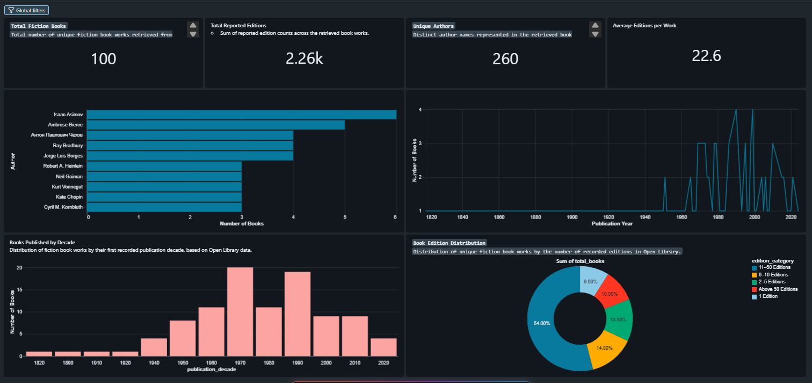

## BookShelf – ReadingRadar 📚
 An End-to-End Data Engineering Project Using Databricks

BookShelf – ReadingRadar is an end-to-end data engineering project that transforms raw book metadata from the **Open Library API** into structured, analytics-ready datasets using the **Medallion Architecture** in Databricks.

The project focuses on fiction book metadata and demonstrates how data can be ingested from an external API, processed through multiple transformation layers, validated for quality, and presented through an interactive analytics dashboard.

---

## 🎯 Project Objectives

- Ingest book metadata from an external REST API.
- Implement a structured Bronze, Silver, and Gold data pipeline.
- Transform semi-structured JSON data into clean, structured datasets.
- Build analytical datasets to explore publication trends, authors, and book editions.
- Implement data quality checks to validate critical Gold-layer records.
- Orchestrate pipeline execution using Databricks Jobs.
- Visualize analytical insights through an interactive Databricks dashboard.

## 🏗️ Architecture

The project follows the **Medallion Architecture**, organizing data into three progressive layers.

| Layer | Description |
|---|---|
| **Bronze – Raw Data** | Ingests book metadata from the Open Library API and stores the raw JSON response. |
| **Silver – Cleaned Data** | Flattens and transforms JSON data, standardizes fields, handles missing values, and removes duplicate records. |
| **Gold – Analytics** | Creates aggregated and analytical datasets for publication trends, author statistics, and edition analysis. |

**Pipeline Flow:**

`Open Library API → Bronze → Silver → Gold → ReadingRadar Dashboard`

## 🛠️ Technology Stack

- **Cloud Data Platform:** Databricks
- **Programming Language:** Python, PySpark
- **Data Processing:** Apache Spark
- **Data Source:** Open Library API
- **Architecture:** Medallion Architecture
- **Analytics & Visualization:** Databricks AI/BI Dashboards
- **Orchestration:** Databricks Jobs
- **Version Control:** Git, GitHub

## ⚙️ Data Pipeline

### 1. Bronze Layer – Data Ingestion
- Retrieves fiction book metadata using the Open Library API.
- Ingests raw API responses in JSON format.
- Preserves the source data for downstream processing.

### 2. Silver Layer – Data Transformation
- Flattens semi-structured JSON records.
- Extracts relevant attributes such as:
  - `work_id`
  - `title`
  - `authors`
  - `first_publish_year`
  - `edition_count`
- Cleans and standardizes identifiers and text fields.
- Removes records with missing required fields.
- Eliminates duplicate work records.

### 3. Gold Layer – Analytical Data
Creates the following analytics-ready datasets:

| Dataset | Purpose |
|---|---|
| `books_gold_by_year` | Number of books by publication year |
| `books_gold_by_author` | Book counts by author |
| `books_gold_by_decade` | Publication trends across decades |
| `books_gold_by_editions` | Book-level edition information |
| `books_gold_edition_distribution` | Distribution of books by edition-count category |
| `books_gold_kpi_summary` | Summary metrics for the dashboard |

## 📊 ReadingRadar – Analytics Dashboard

ReadingRadar is an interactive Databricks dashboard built on the Gold-layer datasets.

### Key Performance Indicators
- Total Fiction Books
- Total Reported Editions
- Unique Authors
- Average Editions per Work

### Visualizations
- Top 10 Authors by Book Count
- Books Published by Decade
- Book Edition Distribution
- Publication Trends by Year

The dashboard provides an analytical view of the collected fiction metadata and helps explore patterns across authors, publication periods, and edition counts.

## ✅ Data Quality Validation

A data quality validation step is implemented in the Gold analytics notebook.

The checks include:

- Missing values in critical fields (`work_id` and `title`).
- Duplicate work identifiers.
- Invalid publication years.
- Negative edition counts.

The validation raises an exception if any critical check fails, preventing the notebook from reporting a successful validation when the data violates these conditions.

## 🔄 Workflow Orchestration

The complete pipeline is orchestrated using a Databricks Job named `ReadingRadar_ETL_Job`.

The job executes three dependent notebook tasks in sequence:

1. `bronze_ingestion`
2. `silver_transformation`
3. `gold_analytics`

Each task runs only after its upstream dependency succeeds. The workflow also has email notifications configured for failed runs.

## 📁 Repository Structure

```text
bookshelf-data-engineering/
│
├── notebooks/
│   ├── 01_bronze_ingestion.ipynb
│   ├── 02_silver_transformation.ipynb
│   └── 03_gold_analytics.ipynb
│
├── README.md
├── requirements.txt
└── .gitignore
```

## 🚀 Getting Started

### Prerequisites
- A Databricks workspace.
- Python and PySpark environment.
- Access to the Open Library API.
- GitHub account for version control.

### Execution Steps
1. Clone the repository or import it into a Databricks Git folder.
2. Open the notebooks in the `notebooks/` directory.
3. Execute the notebooks in the following order:
   - `01_bronze_ingestion.ipynb`
   - `02_silver_transformation.ipynb`
   - `03_gold_analytics.ipynb`
4. Alternatively, execute the complete workflow using the Databricks Job `ReadingRadar_ETL_Job`.
5. Explore the Gold datasets and ReadingRadar dashboard.

## 📸 ReadingRadar Dashboard Preview

The ReadingRadar dashboard brings together key metrics and visual insights from the Gold-layer datasets.


**Dashboard Highlights:**
- 100 Fiction Books
- 2.26K Reported Editions
- 260 Unique Authors
- 22.6 Average Editions per Work

The dashboard includes author rankings, publication trends by year and decade, and book edition distribution.

## 🎓 Key Learning Outcomes

Through this project, I gained practical experience with:

- REST API-based data ingestion.
- Processing semi-structured JSON data.
- PySpark transformations and aggregations.
- Implementing Medallion Architecture.
- Building analytics-ready Gold datasets.
- Performing data quality validation.
- Orchestrating dependent notebook tasks using Databricks Jobs.
- Building interactive dashboards.
- Managing project versions using Git and GitHub.

## 🔗 Data Source

[Open Library API](https://openlibrary.org/developers/api)

---

**BookShelf – ReadingRadar** demonstrates an end-to-end data engineering workflow, from raw API ingestion to structured analytics and dashboard reporting.